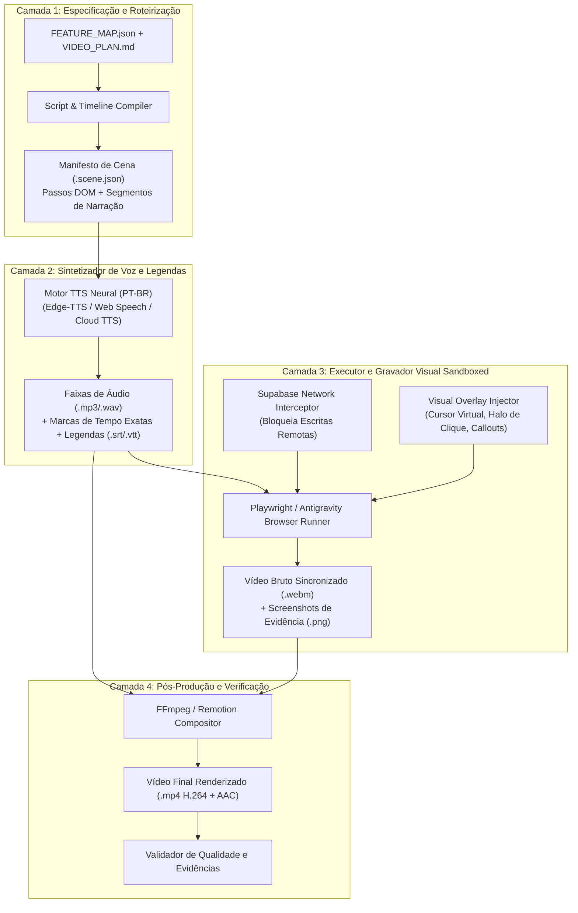

# Plano de Implementação e Arquitetura do Sistema Autônomo de Vídeos Tutoriais

> **Documento gerado na Etapa 1 (Arquitetura Recomendada para a Etapa 2)**
> **Objetivo**: Especificar a arquitetura de engenharia, o pipeline de execução segura e o plano técnico para construir, na próxima etapa, o **Gerador Autônomo de Vídeos Tutoriais Narrados** para o **Workforce ERP v8.0.0-ERP**.

---

## 1. Visão Arquitetural do Sistema Autônomo de Vídeos Tutoriais

O gerador autônomo deverá transformar especificações declarativas de jornadas ([`FEATURE_MAP.json`](file:///d:/Coding/Projects/Escala%20de%20Folga%20Automatizada/docs/ai-tutorials/FEATURE_MAP.json) e [`VIDEO_PLAN.md`](file:///d:/Coding/Projects/Escala%20de%20Folga%20Automatizada/docs/ai-tutorials/VIDEO_PLAN.md)) em **vídeos MP4 (1080p) narrados em Português-BR com legendas sincronizadas e destaques visuais de cursor/foco**, sem intervenção manual e com **isolamento absoluto do banco de dados de produção**.



---

## 2. Componentes da Arquitetura Recomendada

### 2.1 Módulo 1 — `SceneCompiler` (Compilador de Roteiros e Sincronismo)
- **Responsabilidade**: Converter cada tutorial (`VID-01` a `VID-10`) em uma máquina de estados determinística composta por **Cenas (`scenes[]`)**.
- **Estrutura de cada Cena**:
  - `sceneId`: Identificador único da cena (ex.: `VID-01-SCENE-02`).
  - `narrationText`: Texto exato em Português-BR que será narrado.
  - `preActions`: Ações executadas antes de iniciar a fala (ex.: garantir módulo aberto).
  - `timedActions`: Ações de UI (cliques, preenchimento de inputs, hover, scroll) sincronizadas com o progresso do áudio da cena.
  - `highlightSelector`: Seletor DOM que receberá uma moldura/spotlight visual enquanto o narrador explica a regra de negócio.
  - `assertions`: Verificações de DOM obrigatórias para confirmar que a ação produziu o resultado esperado antes de avançar para a próxima cena.

### 2.2 Módulo 2 — `SandboxHarness` (Isolamento de Banco de Dados e Estado)
- **Responsabilidade**: Garantir que **nenhuma gravação altere o Supabase em produção** e que todos os vídeos partam de um estado inicial 100% previsível.
- **Mecanismos Técnicos**:
  1. **Interceptação de Rede HTTP (`page.route`)**:
     - Intercepta `https://*.supabase.co/rest/v1/**` e `https://*.supabase.co/auth/v1/**`.
     - Requisições de escrita (`POST`, `PUT`, `PATCH`, `DELETE`) retornam `HTTP 200` local imediato (`{ status: 200, contentType: "application/json", body: "[]" }`).
     - Requisições de leitura inicial (`GET /rest/v1/configuracoes*`) retornam vazio para forçar o uso controlado do estado injetado no `localStorage` da sessão de gravação.
  2. **Injeção de Estado Determinístico (`addInitScript`)**:
     - Para `VID-01` (Login): Inicia com `sessionStorage` limpo para demonstrar a `TelaLogin`.
     - Para `VID-02` a `VID-10`: Injeta automaticamente a sessão verificada em `sessionStorage` (`erp_v8_verified_operator_session`) e o snapshot da base oficial (`buildInitialErpDatabase()`) em `localStorage` (`erp_relational_db_v8_cache`), garantindo zero latência de rede e 100% de reprodutibilidade.
  3. **Neutralização de Diálogos Nativos Bloqueantes**:
     - Substitui `window.confirm = () => true` (com exibição de um banner visual customizado na tela para que o espectador veja a confirmação no vídeo) e `window.print = () => {}` combinado com `page.emulateMedia({ media: "print" })`.

### 2.3 Módulo 3 — `VisualDirector` (Injetor de UX Cinematográfica no DOM)
Como o navegador headless nativo não desenha o ponteiro físico do mouse do sistema operacional no vídeo gravado, o `VisualDirector` injetará um script leve de UI na página gravada:
1. **Cursor Virtual Animado**: Um ponteiro SVG suave com transição CSS (`cubic-bezier`) que se move até o centro do elemento alvo antes de cada clique.
2. **Efeito Ripple de Clique**: Animação concêntrica amarela/azul no exato momento do `click()`.
3. **Spotlight / Destaque de Seção**: Borda pulsante (`box-shadow: 0 0 0 4px rgba(37, 99, 235, 0.6)`) ao redor do card, tabela ou botão que está sendo explicado pela narração.
4. **Lower-Third / Barra de Legenda Integrada (Opcional)**: Faixa discreta na parte inferior ou geração de arquivo `.srt`/`.vtt` para legendas queimadas ou selecionáveis.

### 2.4 Módulo 4 — `NarrationSynthesizer` (Motor TTS Neural PT-BR)
- **Responsabilidade**: Gerar os arquivos de áudio `.mp3`/`.wav` de cada cena **antes** da execução da gravação no navegador (*Audio-First Synchronization*).
- **Por que *Audio-First*?**:
  - Ao sintetizar o áudio de cada cena primeiro, sabemos a **duração exata em milissegundos** de cada fala (ex.: `Cena 2 = 14.320 ms`).
  - O runner do navegador utiliza essa duração exata para cadenciar os movimentos do cursor, cliques e pausas de leitura na tela, eliminando qualquer dessincronização entre o que o narrador fala e o que aparece no vídeo!
- **Opções de Provedor TTS**:
  - **Opção A (Zero Custo / Local)**: `edge-tts` / `node-edge-tts` (vozes neurais Microsoft PT-BR `pt-BR-AntonioNeural` ou `pt-BR-FranciscaNeural`).
  - **Opção B (Cloud / API)**: Google Cloud Text-to-Speech (`pt-BR-Neural2-B`) ou ElevenLabs / OpenAI TTS caso configurado pelo usuário.

### 2.5 Módulo 5 — `VideoCompositor` (Montagem e Masterização Final)
- **Responsabilidade**: Unir o vídeo capturado pelo navegador (`1920x1080`, `30fps`) com as faixas de áudio de cada cena e as legendas `.srt`.
- **Pipeline de Pós-Produção (FFmpeg)**:
  1. Concatena os segmentos de áudio nos timestamps exatos registrados no log de execução do runner (`timeline_events.json`).
  2. Combina o vídeo `.webm` com a trilha de áudio masterizada e aplica normalização de volume (`loudnorm`).
  3. Exporta o arquivo final `.mp4` (codec de vídeo `libx264`, `pix_fmt yuv420p`, codec de áudio `aac`) em `docs/ai-tutorials/videos/` junto com as evidências de validação em `docs/ai-tutorials/evidence/`.

---

## 3. Fases de Execução Recomendadas para a Etapa 2

### Fase 2.1 — Exploração Visual Automatizada e Promoção de Status (`FEATURE_MAP.json`)
1. Subir o servidor Vite local (`npm run dev`) em ambiente controlado.
2. Executar o script de verificação visual com o **Supabase Network Interceptor** ativo para percorrer todas as 18 funcionalidades de `FEATURE_MAP.json`.
3. Capturar os screenshots de evidência de cada módulo e atualizar o status em `FEATURE_MAP.json` de `PARCIALMENTE CONFIRMADA` para `CONFIRMADA`.

### Fase 2.2 — Construção do Motor de Gravação (`scripts/tutorial-generator/`)
Criar uma estrutura isolada fora de `src/` (para **não modificar o código de produção**):
```text
scripts/
└── tutorial-generator/
    ├── config.js                  # Resolução 1920x1080, URLs, vozes TTS e diretórios
    ├── sandboxInterceptor.js      # Bloqueio de escritas Supabase + Seed Injector
    ├── visualOverlay.js           # Cursor virtual animado, ripple de clique e spotlight
    ├── ttsSynthesizer.js          # Geração de áudio PT-BR e cálculo de duração por cena
    ├── scenes/                    # Definições declarativas das cenas (VID-01 a VID-10)
    ├── runner.js                  # Executor Playwright Audio-First + Captura de Vídeo
    └── compositor.js              # Mixagem FFmpeg (Vídeo + Áudio + Legendas SRT -> MP4)
```

### Fase 2.3 — Gravação Piloto (`VID-01` e `VID-02`) e Produção Completa (`VID-01` a `VID-10`)
1. Gerar inicialmente o vídeo piloto `VID-01` (Login Nominal e Contexto Global) e `VID-02` (Dashboard Executivo) para validação de ritmo, voz e enquadramento.
2. Após validação, executar a fila completa de produção gerando os 10 vídeos tutoriais (`VID-01` a `VID-10`) e o catálogo navegável de treinamento.

---

## 4. Pré-Requisitos Técnicos e Aprovações Necessárias para a Etapa 2

Como na Etapa 1 nenhuma dependência extra foi instalada (respeitando as restrições do projeto), para iniciar a implementação na **Etapa 2** serão necessárias:
1. **Ferramenta de Automação de Navegador com Gravação de Vídeo**:
   - Uso do navegador integrado do Antigravity (para exploração visual e captura de evidências) e/ou instalação de `@playwright/test` (`playwright`) como `devDependency` para gravação nativa determinística de vídeo `1920x1080` (`recordVideo`).
2. **Ferramenta de Síntese de Voz (TTS) e Mixagem de Vídeo**:
   - Verificação de disponibilidade do `ffmpeg` no sistema operacional (ou `ffmpeg-static` em `devDependencies`) e pacote leve de TTS neural em Português-BR.
3. **Zero Alteração no Código de Produção**:
   - Todo o gerador residirá em `scripts/tutorial-generator/` e os artefatos multimídia em `docs/ai-tutorials/`, mantendo `src/` 100% intacto.
